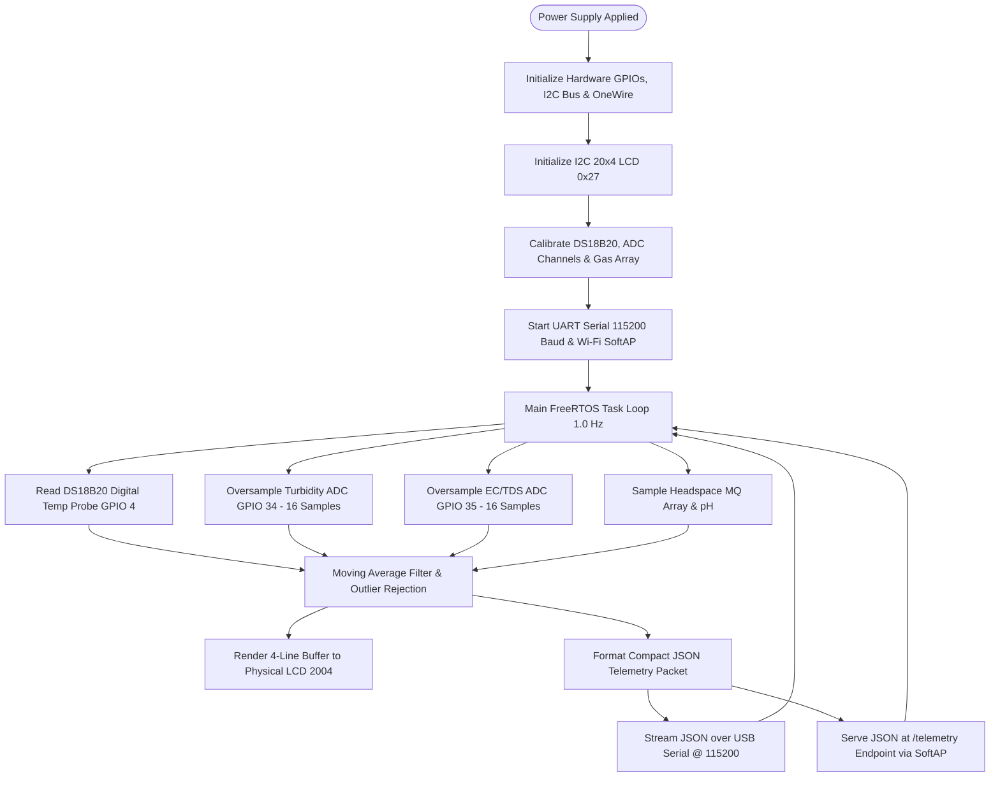

# MilkGuard: Smart Milk Quality & Adulteration Verification System
## Comprehensive Technical Project Documentation

---

### Executive Summary

**MilkGuard** is an end-to-end cyber-physical IoT verification platform designed for real-time milk quality evaluation, spoilage detection, and adulteration screening at the point of collection. 

Traditional raw milk quality assessment relies either on subjective sensory inspection (smell, visual check) or centralized laboratory chemical assays (e.g., Gerber fat test, Kjeldahl nitrogen determination, bacterial plate count). These traditional methods are either unreliable or introduce significant latency (several hours to days), making them impractical for rapid intake grading at collection booths, chilling centers, and cooperative dairy hubs.

MilkGuard bridges this critical gap by combining:
1. **A dedicated ESP32-powered multi-sensor acquisition edge node** that simultaneously probes physical, optical, electrochemical, and volatile headspace properties of raw milk specimens.
2. **An embedded I2C character LCD display** for immediate standalone visual inspection in rural or off-grid collection booths.
3. **A modern Progressive Web Application (PWA)** that interfaces directly with the hardware via WebSerial (USB) or Wi-Fi Direct, providing automated dual-classification (Spoilage vs. Adulteration), interactive telemetry curves, batch traceability, and audit reporting.

```
┌─────────────────────────────────────────────────────────────────────────────┐
│                           SYSTEM BLOCK ARCHITECTURE                         │
└─────────────────────────────────────────────────────────────────────────────┘

                           [ REGULATED POWER SUPPLY ]
                                  (5V / 3.3V)
                                       │
                                       ▼
  ┌──────────────────────┐      ┌──────────────┐      ┌─────────────────────┐
  │    SENSOR INPUTS     │      │  EDGE MCU    │      │       OUTPUTS       │
  ├──────────────────────┤      ├──────────────┤      ├─────────────────────┤
  │ • DS18B20 Temp Probe │─────►│              │─────►│ 20x4 Character LCD  │
  │   (GPIO 4 / 1-Wire)  │      │    ESP32     │      │ (I2C: GPIO 21 & 22) │
  │                      │      │  Dual-Core   │      │                     │
  │ • Optical Turbidity  │─────►│    240MHz    │      │                     │
  │   (GPIO 34 / ADC1)   │      │              │      ├─────────────────────┤
  │                      │      │ FreeRTOS C++ │─────►│ Web Dashboard (PWA) │
  │ • Conductivity / TDS │─────►│  Acquisition │      │ (USB Serial/Wi-Fi)  │
  │   (GPIO 35 / ADC1)   │      │    Engine    │      │ Real-time Telemetry │
  │                      │      │              │      │ Dual Classification │
  │ • Auxiliary Arrays   │─────►│              │      │ Batch Traceability  │
  │   (pH & MQ Gas)      │      │              │      │ Audit Records       │
  └──────────────────────┘      └──────────────┘      └─────────────────────┘
```

---

## 1. Hardware Engineering Architecture

### 1.1 Microcontroller Unit (MCU): ESP32 DevKit V1
The system controller is the **Espressif ESP32** (Tensilica Xtensa Dual-Core 32-bit LX6 microprocessor operating at 240 MHz). It was chosen for:
- High-frequency multi-channel ADC sampling.
- Hardware support for I2C, UART, and 1-Wire protocols.
- Integrated 2.4 GHz Wi-Fi (802.11 b/g/n) with SoftAP support for standalone wireless operation.
- Low power consumption and deterministic FreeRTOS task scheduling.

### 1.2 Hardware Pinout & Interface Mapping

| Subsystem / Peripheral | Hardware Component | Interface / Protocol | ESP32 GPIO Pin | Operating Voltage | Function / Measurement |
| :--- | :--- | :--- | :--- | :--- | :--- |
| **Microcontroller** | ESP32 DevKit V1 | Main Processor | — | 5V USB / VIN | Core execution, ADC conversion, LCD & telemetry driver |
| **Temperature Sensor** | Dallas DS18B20 | Dallas 1-Wire | **GPIO 4** | 3.3V – 5.0V | Liquid specimen temperature (°C) & thermal abuse audit |
| **Turbidity Sensor** | Optical Phototransistor Probe | Analog Voltage (ADC1_CH6) | **GPIO 34** | 5.0V (VCC) / 0–4.5V ADC | Optical transmittance / turbidity (NTU), fat dilution, coagulation |
| **Conductivity / TDS** | Bipolar Platinum/Stainless Probe | Analog Voltage (ADC1_CH7) | **GPIO 35** | 3.3V – 5.0V | Electrical conductivity (mS/cm), ionic salts, added urea |
| **Local Display** | LCD 2004 (20x4) / 1602 with PCF8574 | I2C (Address: 0x27) | **SDA: GPIO 21**<br>**SCL: GPIO 22** | 5.0V | Standalone operator output (Quality score, spoilage, adulteration) |
| **pH Sensing (Aux)** | Analog Glass pH Electrode | Analog Voltage (ADC1_CH4) | **GPIO 32** | 5.0V / Signal conditioning | Potentiometric acidity/alkalinity evaluation |
| **Gas Array (Aux)** | MQ-3 (Ethanol/VOC) | Analog Voltage (ADC1_CH0) | **GPIO 36 (VP)** | 5.0V Heater | Headspace ethanol from microbial fermentation |
| **Gas Array (Aux)** | MQ-135 (Air/Sulfides) | Analog Voltage (ADC1_CH3) | **GPIO 39 (VN)** | 5.0V Heater | Headspace volatile sulfur compounds & organic gases |
| **Gas Array (Aux)** | MQ-137 (Ammonia) | Analog Voltage (ADC2_CH3) | **GPIO 15** | 5.0V Heater | Headspace amines & ammonia from protein putrefaction |
| **Power Supply** | Regulated DC Converter | Linear LDO / Buck | **5V, 3V3, GND** | 5.0V Input | Low-noise ripple-suppressed power bus |

> [!IMPORTANT]
> The analog sensors (Turbidity, Conductivity, pH, MQ gas) are mapped exclusively to **ADC1** pins (GPIO 32–39). In the ESP32 architecture, **ADC2** pins cannot be sampled reliably while the Wi-Fi subsystem is transmitting. Restricting primary analog telemetry to ADC1 ensures 100% deterministic sensor reading during Wi-Fi transmission.

---

### 1.3 Sensor Operating Principles & Physicochemical Correlation

#### 1. DS18B20 Digital Temperature Probe
- **Physics**: Digital thermal sensor using an onboard bandgap temperature measurement circuit with 12-bit analog-to-digital resolution (0.0625°C step).
- **Physical Integration**: Connected via 1-Wire bus to GPIO 4 with a dedicated 4.7 kΩ pull-up resistor between data line and 3.3V rail.
- **Biochemical Role**: Raw milk freshly milked is ~37°C and must be chilled immediately to 4.0°C–6.0°C. Temperature > 25.0°C exponentially accelerates lactic acid bacteria (*Lactococcus lactis*) proliferation. Monitoring specimen temperature allows temperature compensation across electrical conductivity readings and detects thermal abuse during transit.

#### 2. Optical Turbidity Sensor (Infrared Phototransistor)
- **Physics**: Measures light transmittance through the liquid specimen. An infrared LED (wavelength ~940 nm) emits light through a glass tube specimen chamber toward a phototransistor.
  - Undiluted whole milk contains suspension of fat globules (micelles) and casein proteins that scatter light intensely (high turbidity / low light transmittance).
  - Water dilution increases optical transmittance, reducing measured turbidity.
  - Acid coagulation or curdling creates clumped flocs of casein, dramatically altering light scatter and generating abnormal high-turbidity peaks (> 3200 NTU).
- **Formula**:
  $$\text{Voltage} = \frac{V_{\text{ADC}}}{4095} \times 3.3 \text{ V}$$
  $$\text{Turbidity (NTU)} = -1120.4 \times V^2 + 5742.3 \times V - 4352.9 \quad (100 \le \text{NTU} \le 4000)$$

#### 3. Electrical Conductivity (EC / TDS) Sensor
- **Physics**: Measures the ionic charge carrier mobility between two corrosion-resistant electrode pins submerged in the specimen. 
- **Biochemical Role**:
  - Fresh natural bovine milk possesses a stable electrolyte balance of chlorides, citrates, potassium, and sodium, corresponding to a nominal conductivity of **4.00 – 5.50 mS/cm**.
  - **Water Dilution**: Diluting milk with water decreases ionic concentration, lowering conductivity below **3.50 mS/cm**.
  - **Salt / Urea / Fertilizer Adulteration**: Unscrupulous producers often add sodium chloride, urea, or ammonium sulfate to artificially restore the specific gravity of watered-down milk. This drastically elevates ionic charge mobility, driving conductivity above **6.00 – 6.50 mS/cm**.

#### 4. Potentiometric pH Glass Electrode
- **Physics**: Generates an electrical potential difference across a thin glass membrane proportional to hydrogen ion ($H^+$) concentration according to the Nernst equation:
  $$E = E^0 - \frac{2.303 RT}{F} \log_{10}[H^+]$$
- **Biochemical Role**:
  - Fresh milk has a slightly acidic to neutral pH: **6.50 – 6.70**.
  - Bacterial spoilage converts lactose into lactic acid via fermentation, dropping pH below **6.40 (spoiling)** and **< 6.20 (curdled/spoiled)**.
  - Adding chemical neutralizers (sodium hydroxide, sodium bicarbonate) to disguise souring milk drives pH into the alkaline zone (**> 6.90**).

#### 5. Headspace Volatile Gas Array (MQ-3, MQ-135, MQ-137)
- **Physics**: Metal Oxide Semiconductor (MOS) sensors whose surface conductivity increases when reducing or volatile gases adsorb onto heated tin dioxide ($SnO_2$) nanoparticles.
- **MQ-3 (Ethanol / VOC)**: Detects ethanol produced as a metabolic byproduct by wild yeasts and heterofermentative bacteria during lactic fermentation.
- **MQ-135 (Air Quality / Sulfides)**: Detects hydrogen sulfide and volatile organic acids produced during early proteolysis.
- **MQ-137 (Ammonia / Amines)**: High specificity for ammonia and trimethylamines generated when milk proteins decompose under putrefactive microbial attack.

#### 6. I2C Character LCD Display (2004 / 1602)
- Driven by a **PCF8574 I2C I/O expander backpack** operating at address `0x27` over hardware I2C (`GPIO 21: SDA`, `GPIO 22: SCL`).
- Provides instantaneous autonomous operator feedback with 4 lines:
  - Line 1: System Title, Quality Percentage, and Overall Verdict
  - Line 2: DS18B20 Temperature and Optical Turbidity
  - Line 3: Electrical Conductivity and Adulteration Flag
  - Line 4: ESP32 Hardware Status and Bus Health

---

## 2. Firmware Architecture & Data Acquisition (ESP32)

The firmware is developed in Arduino C++ utilizing FreeRTOS multi-tasking capabilities.



### 2.1 Oversampling & Non-Linearity Filtering
ESP32 ADC pins can exhibit non-linear response curves near 0V and 3.3V rails. The firmware implements:
1. **16-Sample Hardware Oversampling**: Mitigates thermal noise and mains hum (50/60 Hz EMI).
2. **Exponential Moving Average (EMA)**:
   $$S_t = \alpha \cdot Y_t + (1 - \alpha) \cdot S_{t-1} \quad (\alpha = 0.25)$$
   Stabilizes analog turbidity and conductivity channels against liquid turbulence when milk is poured into the vessel.

### 2.2 Telemetry Packet Format (JSON Stream)
Every 1000 ms, the ESP32 transmits a high-density, standardized JSON frame over both USB UART (115200 baud) and Wi-Fi SoftAP:

```json
{
  "node": "ESP32-MG001",
  "uptime": 3600,
  "temp": 18.4,
  "turb": 2450,
  "turbV": 3.82,
  "ec": 4.65,
  "ph": 6.64,
  "mq3": 132,
  "mq135": 270,
  "mq137": 84,
  "humidity": 58,
  "lcd": [
    "MILKGUARD 96% GOOD  ",
    "T:18.4C TURB:2450N  ",
    "EC:4.65mS ADLT:NO   ",
    "HW:ESP32+DS18B20 OK "
  ]
}
```

---

## 3. Software Architecture (PWA Application)

The software is engineered as a **Progressive Web Application (PWA)** built with Vite, React 19, TypeScript, and modern responsive CSS. It delivers the speed and capabilities of a desktop application with native-like mobile deployment.

```
┌─────────────────────────────────────────────────────────────────────────────┐
│                       PWA MULTI-TIER ARCHITECTURE                           │
└─────────────────────────────────────────────────────────────────────────────┘

  ┌─────────────────────────────────────────────────────────────────────────┐
  │                           PRESENTATION TIER                             │
  │  • Dashboard Page         • Live Analysis Page     • Test History Page  │
  │  • Batch Management Page  • Device Status Page     • Analytics Page     │
  │  • Settings Page          • Test Details Report    • Hardware LCD Frame │
  └─────────────────────────────────────────────────────────────────────────┘
                                     │
                                     ▼
  ┌─────────────────────────────────────────────────────────────────────────┐
  │                         ANALYTICS & STATE TIER                          │
  │  • SimulationContext       • ThemeContext (Adaptive Light/Dark Modes)   │
  │  • Milk Classification Heuristic Array (Dual State Matrix)              │
  │  • Time-Series Interpolation & Recharts Telemetry Visualizer            │
  └─────────────────────────────────────────────────────────────────────────┘
                                     │
                                     ▼
  ┌─────────────────────────────────────────────────────────────────────────┐
  │                        HARDWARE DRIVER TIER                             │
  │  • WebSerial Driver (Chrome/Edge navigator.serial @ 115200 baud)        │
  │  • Wi-Fi Direct Driver (SoftAP HTTP polling from 192.168.4.1/telemetry) │
  │  • Cloud REST API Driver (Standalone standby for MongoDB backend)       │
  │  • HardwarePluginManager (Auto-discovery, packet parsing, fallback)     │
  └─────────────────────────────────────────────────────────────────────────┘
                                     │
                                     ▼
  ┌─────────────────────────────────────────────────────────────────────────┐
  │                    OFFLINE & PERSISTENCE TIER                           │
  │  • Workbox Service Worker (Shell caching, zero-network availability)    │
  │  • LocalStorage & IndexedDB audit logs with JSON/CSV file exporters     │
  └─────────────────────────────────────────────────────────────────────────┘
```

### 3.1 Plug-and-Play Hardware Connectivity System

The application features a decoupled hardware abstraction layer (`HardwarePluginManager`) that enables zero-recompilation switching between physical hardware and standby modes:

1. **Direct USB Web Serial (`navigator.serial`)**:
   - Enables direct hardware connectivity over standard USB-C or Micro-USB cables without installing CH340 or CP2102 drivers on host machines.
   - Operates in Chrome, Microsoft Edge, and Opera on Windows, macOS, Linux, and Android.
   - Reads incoming data streams using `TextDecoderStream` pipeline with non-blocking line splitting.
2. **Wi-Fi Direct SoftAP Driver**:
   - For handheld smartphones or tablets inspecting milk samples in farm collection centers.
   - The device connects directly to the ESP32's self-hosted wireless hotspot (`SSID: MilkGuard-ESP32`).
   - Telemetry is fetched through non-blocking HTTP polling with automated packet loss mitigation.
3. **Standby Cloud REST API Driver**:
   - Prepared endpoint gateway (`VITE_API_BASE_URL`) for forwarding batches and inspection logs to a centralized Node.js/Express + MongoDB server.

---

### 3.2 Dual-Theme Adaptive Visual System

The user interface implements an adaptive layout with high-contrast accessibility:
- **Tailwind v4 Custom Dark Variant**: Configured with `@custom-variant dark (&:where(.dark, .dark *));` to guarantee instant client-side theme toggling that overrides operating system color preferences.
- **Light Theme**: Engineered specifically for high-glare dairy collection environments (direct sunlight, open sheds). Features a clean white (`bg-white`) and slate-50 canvas, high-contrast slate-900 typography, and vivid emerald status indicators.
- **Dark Theme**: Premium high-contrast terminal styling (`bg-slate-950`) designed for laboratory and low-light operation.

---

## 4. Dual Classification & Quality Scoring Matrix

Unlike rudimentary milk analyzers that generate an ambiguous "Good" or "Bad" label, MilkGuard evaluates specimens across **two strictly independent dimensions**:
1. **Biological Spoilage State** (Microbial freshness, lactic fermentation, putrefaction)
2. **Adulteration State** (External chemical, water, or ionic solute contamination)

This distinction is crucial: **milk can be completely fresh yet heavily adulterated with water or urea, or it can be completely pure yet sour and curdled due to heat abuse.**

```
                              CLASSIFICATION MATRIX
                      ┌──────────────────────────────────────┐
                      │          ADULTERATION STATE          │
                      ├──────────────────┬───────────────────┤
                      │   NOT DETECTED   │     DETECTED      │
 ┌─────────┬──────────┼──────────────────┼───────────────────┤
 │         │   GOOD   │   GRADE A MILK   │  ECONOMIC FRAUD   │
 │         │ (Fresh)  │ (Pass / Process) │ (Water/Urea Flag) │
 │ SPOILAGE├──────────┼──────────────────┼───────────────────┤
 │  STATE  │ SPOILING │  EARLY FERMENT   │  CONTAMINATED &   │
 │         │ (Tainted)│ (Cool or Grade C)│  RAPID SOURING    │
 │         ├──────────┼──────────────────┼───────────────────┤
 │         │ SPOILED  │ BACTERIAL DECAY  │ CRITICAL HAZARD   │
 │         │ (Curdled)│  (Reject Batch)  │ (Reject & Report) │
 └─────────┴──────────┴──────────────────┴───────────────────┘
```

### 4.1 Quantitative Boundary Rules

| Parameter | Nominal Raw Milk | Warning / Degraded | Critical Fault / Adulteration Flag | Diagnostic Implication |
| :--- | :--- | :--- | :--- | :--- |
| **DS18B20 Temperature** | 4.0 – 8.0 °C | 8.1 – 25.0 °C | **> 28.0 °C** | Broken cold chain; exponential bacterial growth window |
| **Optical Turbidity** | 1800 – 3000 NTU | 1400 – 1799 NTU | **< 1400 NTU**<br>**> 3200 NTU** | **< 1400:** Water dilution or fat skimming<br>**> 3200:** Casein coagulation & curdling |
| **Conductivity (EC/TDS)**| 4.00 – 5.50 mS/cm | 3.50 – 3.99 mS/cm | **< 3.50 mS/cm**<br>**> 6.20 mS/cm** | **< 3.50:** Water dilution (reduced electrolytes)<br>**> 6.20:** Added ionic salts, urea, or caustic neutralizers |
| **pH Acidity** | 6.50 – 6.70 pH | 6.20 – 6.45 pH | **< 6.20 pH**<br>**> 6.90 pH** | **< 6.20:** Lactic acid souring<br>**> 6.90:** Added neutralizer (NaOH / $NaHCO_3$) |
| **MQ-3 (Ethanol)** | 100 – 180 ADC | 181 – 300 ADC | **> 300 ADC** | Microbial ethanol byproduct from wild yeast fermentation |
| **MQ-135 (Air/Sulfides)**| 200 – 320 ppm | 321 – 450 ppm | **> 450 ppm** | Headspace volatile sulfur compounds from early decomposition |
| **MQ-137 (Ammonia)** | 50 – 120 ppm | 121 – 200 ppm | **> 200 ppm** | Volatile amines & free ammonia from severe protein putrefaction |

### 4.2 Milk Quality Score Formulation ($0 \dots 100$)

The overall composite Milk Quality Score is computed deterministically:
$$\text{Score} = 100 - \Delta_{\text{Spoilage}} - \Delta_{\text{Adulteration}} - \Delta_{\text{Thermal}} - \Delta_{\text{Turbidity}}$$

Where:
- $\Delta_{\text{Spoilage}} = 0$ (Good), $24$ (Spoiling), or $52$ (Spoiled)
- $\Delta_{\text{Adulteration}} = 28 \times N_{\text{adulterants}}$ ($N \ge 1$ if water, ionic salt, or alkaline chemical detected)
- $\Delta_{\text{Thermal}} = 5$ (if specimen temperature $> 25.0\text{°C}$ while un-soured)
- $\Delta_{\text{Turbidity}} = 10$ (if turbidity $< 1800\text{ NTU}$ indicating lower fat content without full adulteration flag)
- $\text{Quality Score}$ is constrained to $[12 \dots 99]\%$.

---

## 5. Software Feature Set & Workflow Guide

```
 ┌──────────────────────┐     ┌──────────────────────┐     ┌──────────────────────┐
 │   1. BATCH INTAKE    │     │   2. SENSOR PROBING  │     │  3. VERIFICATION     │
 │ Register farmer ID,  │────►│ Insert probes into   │────►│ Dual classification  │
 │ volume in liters,    │     │ milk vessel; stream  │     │ generated in 4.5s;   │
 │ and collection time  │     │ 1Hz multi-sensor data│     │ LCD & PWA updated    │
 └──────────────────────┘     └──────────────────────┘     └──────────────────────┘
                                                                      │
 ┌──────────────────────┐     ┌──────────────────────┐                ▼
 │   5. AUDIT EXPORT    │     │   4. TRACEABILITY    │     ┌──────────────────────┐
 │ Export batch report  │◄────│ Record logged into   │◄────│ Batch Acceptance     │
 │ as structured JSON / │     │ local IndexedDB /    │     │ or Automated Flag    │
 │ CSV inspection audit │     │ cloud audit log      │     │ for Rejection        │
 └──────────────────────┘     └──────────────────────┘     └──────────────────────┘
```

1. **Dashboard (`/`)**:
   - Central overview with real-time physical sensor gauges.
   - High-contrast live **LCD 2004 Mirror widget** that updates synchronously with the physical LCD screen.
   - Aggregate lifetime acceptance rate, test counts, and quick launch triggers.
2. **Live Analysis (`/live`)**:
   - High-frequency 1 Hz multi-channel live graph tracking thermal, optical, ionic, and gas curves simultaneously.
   - 4-step guided verification cycle (Sensor Zeroing ➔ Thermal Stabilization ➔ Telemetry Sampling ➔ Model Evaluation).
3. **Batch Management (`/batches`)**:
   - Organizes collections by farmer ID, supplier cooperative, and container volume.
   - Calculates batch-level pass rates and links individual tests to physical milk cans.
4. **Device Diagnostics (`/device`)**:
   - Interactive visual schematic diagram of the ESP32 edge node matching the hardware architecture.
   - Built-in hardware diagnostics self-test verifying 1-Wire, I2C, and ADC pin health.
   - Direct download link for the ready-to-flash Arduino firmware (`.ino`).
5. **Test History & Verification Reports (`/history`, `/history/:id`)**:
   - Complete historical ledger of every verified milk sample with timestamps and operator notes.
   - Interactive 10-second thermalization curve snapshot.
   - One-click JSON / CSV export for regulatory reporting.
6. **Settings & Custom Calibration (`/settings`)**:
   - Instant visual theme toggle (Light / Dark).
   - Configurable measurement units (Celsius / Fahrenheit, mS/cm / µS/cm).
   - Hardware connection manager and baseline threshold reference.

---

## 6. Cloud Integration Architecture (Future Node.js / MongoDB Backend)

When transitioning from the edge PWA to a centralized enterprise dairy network, the software architecture includes pre-configured service abstractions:

```
┌─────────────────────────────────────────────────────────────────────────────┐
│                    CENTRALIZED LAB DEPLOYMENT TOPOLOGY                      │
└─────────────────────────────────────────────────────────────────────────────┘

 [ Collection Booth 1 ] ──┐
   (ESP32 + PWA Device)   │
                          ├─────► [ Node.js / Express Gateway ] ─────► [ MongoDB Atlas ]
 [ Collection Booth 2 ] ──┤         REST API /api/tests                 Central Database
   (ESP32 + PWA Device)   │         JWT Authentication                  • Test Records
                          │         Multi-Tenant Validation             • Farmer Profiles
 [ Mobile Inspector ] ────┘                                             • Quality Audits
   (Smartphone PWA)
```

### Proposed MongoDB Document Schema

```json
{
  "_id": "ObjectId('671e3b52f1a23b49c0d12345')",
  "testId": "T042",
  "batchId": "BATCH-004",
  "deviceId": "ESP32-MG001",
  "timestamp": "2026-10-27T03:45:00.000Z",
  "farmerInfo": {
    "farmerId": "FARMER-012",
    "name": "Sunrise Cooperative",
    "volumeLiters": 350
  },
  "sensors": {
    "temperature": 19.2,
    "turbidity": 2450,
    "turbidityVoltage": 3.82,
    "conductivity": 4.65,
    "ph": 6.62,
    "mq3": 135,
    "mq135": 275,
    "mq137": 85,
    "humidity": 58
  },
  "classification": {
    "spoilage": "GOOD",
    "adulteration": "NOT_DETECTED",
    "qualityScore": 96,
    "confidence": 96.4,
    "detectedAdulterants": [],
    "verdictSummary": "Safe for processing & human consumption. Meets all raw milk quality standards."
  },
  "auditMetadata": {
    "operatorNote": "Morning collection intake. Specimen nominal.",
    "firmwareVersion": "v1.0.0",
    "connectionType": "WEB_SERIAL"
  }
}
```

---

## 7. Bill of Materials (BOM) & Component Specifications

| Item | Component Description | Model / Part Number | Key Specifications | Quantity |
| :---: | :--- | :--- | :--- | :---: |
| 1 | Microcontroller Dev Board | ESP32 DevKit V1 (30-pin) | Dual-Core 240MHz, 520KB SRAM, 4MB Flash | 1 |
| 2 | Digital Temperature Probe | Dallas DS18B20 (Waterproof) | Stainless steel probe, 1-Wire, ±0.5°C (-10°C to +85°C) | 1 |
| 3 | Optical Turbidity Sensor | SKU SEN0189 / TSW-20M | Infrared 940nm emitter/phototransistor, 0–4.5V output | 1 |
| 4 | Electrical Conductivity Probe | Analog EC / TDS Meter V1.0 | Titanium alloy pins, 0–10 mS/cm range | 1 |
| 5 | Liquid Crystal Display | 2004 Character LCD (Blue/Yellow) | 20 columns × 4 rows, HD44780 controller | 1 |
| 6 | I2C LCD Backpack | PCF8574 I2C Adapter | Fixed I2C address 0x27 / 0x3F, 100 kHz bus speed | 1 |
| 7 | Pull-up Resistor | Metal Film Resistor | 4.7 kΩ (0.25W) for DS18B20 1-Wire Bus | 1 |
| 8 | Power Supply Module | Step-Down Buck / LDO | Input: 9V–12V DC; Output: 5V @ 2A & 3.3V @ 1A | 1 |
| 9 | Signal Conditioning Board | Custom PCB / Breadboard | Star ground topology, decoupling capacitors (0.1µF & 10µF)| 1 |
| 10 | Host Machine / Mobile | Smartphone, Tablet, or PC | Chromium-based browser supporting WebSerial or Wi-Fi | 1 |

---

### Conclusion

The **MilkGuard** platform delivers an integrated, cost-effective, and scientifically rigorous solution for decentralized milk testing. By unifying multi-parametric hardware sensing (temperature, optical turbidity, and electrical conductivity) with local I2C LCD readout and a responsive, offline-ready Progressive Web App, MilkGuard ensures dairy processors and consumers obtain uncompromising food safety and traceability at the earliest possible stage in the supply chain.
